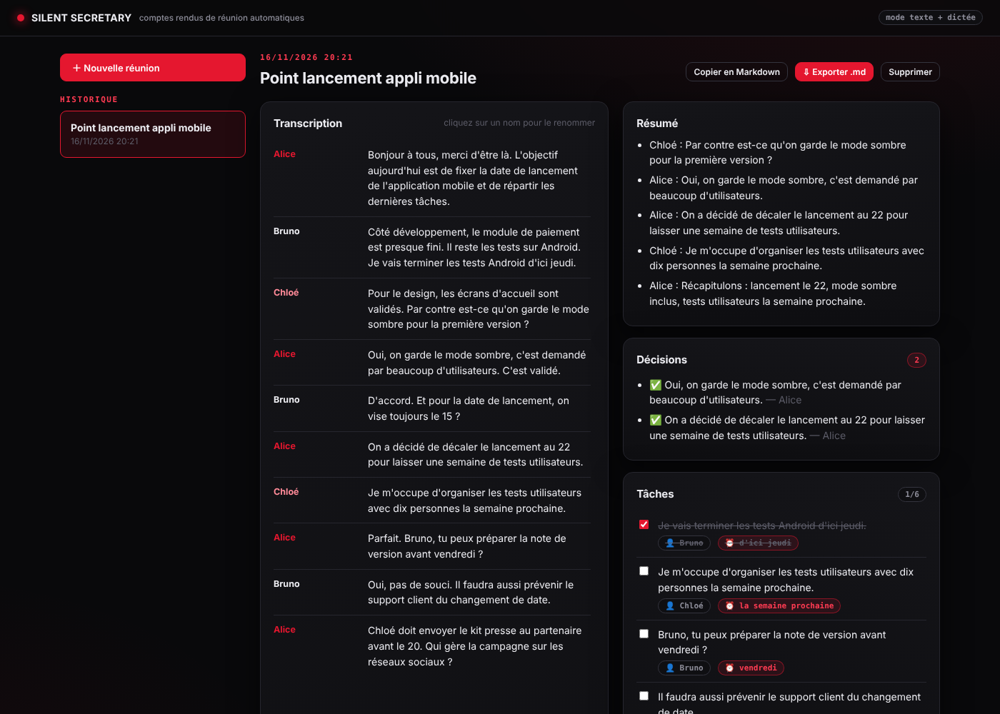

# 🎙 Silent Secretary

> Transcrit une réunion, distingue les intervenants et génère un compte rendu avec décisions, tâches et questions ouvertes.



## Trois façons de capturer une réunion
1. **Dictée en direct** : reconnaissance vocale du navigateur (Chrome / Edge). On change d'intervenant avec les touches **1 à 9** et on renomme d'un double-clic.
2. **Fichier audio** : transcription **Whisper** puis **diarisation** maison (empreinte spectrale + hauteur de voix, K-means, nombre d'intervenants choisi par score de silhouette).
3. **Transcription existante** : `Nom: texte`, SRT, VTT ou texte brut.

## Le compte rendu
- **Résumé extractif** : phrases les plus porteuses selon TF-IDF, ordre chronologique conservé, décisions favorisées.
- **Décisions** : « on a décidé », « c'est validé », « on part sur », « agreed »… Une confirmation courte (« C'est validé. ») est rattachée à la phrase qu'elle valide.
- **Tâches** avec **responsable** (« je vais… », « Bruno, tu peux… », « Marc pourrait s'en charger ») et **échéance** (« d'ici jeudi », « avant le 20 »…). On peut les cocher et les réattribuer.
- **Questions restées sans réponse**, **sujets clés** et **temps de parole** de chaque intervenant.
- Export **Markdown** (fichier ou presse-papiers), historique enregistré dans SQLite.

Tout le traitement du langage est local : aucune donnée ne quitte la machine.

## Lancer
```bash
pip install -r requirements.txt          # + openai-whisper pour les fichiers audio
python app.py                            # → http://127.0.0.1:5003
python -m pytest -q
```

## Structure
```
secretary/nlp.py    analyse de la transcription (FR + EN)
secretary/audio.py  Whisper + diarisation (NumPy / scikit-learn)
app.py              API Flask + persistance SQLite
static/             interface
```

## Pistes
- Diarisation par embeddings neuronaux (pyannote) pour les réunions à plus de quatre personnes
- Résumé abstractif par LLM en option
- Envoi automatique du compte rendu par e-mail ou sur Slack

## Licence
MIT © Jimo0x
